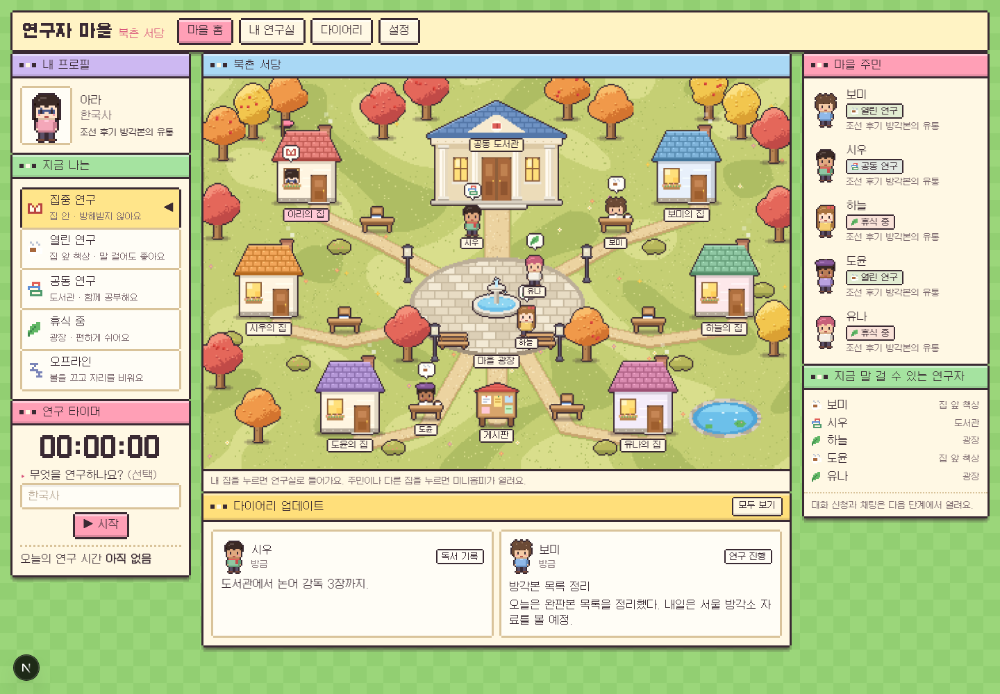
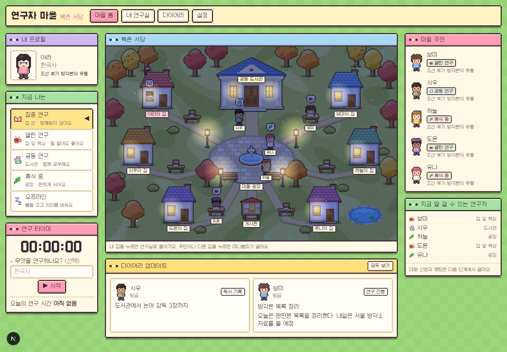
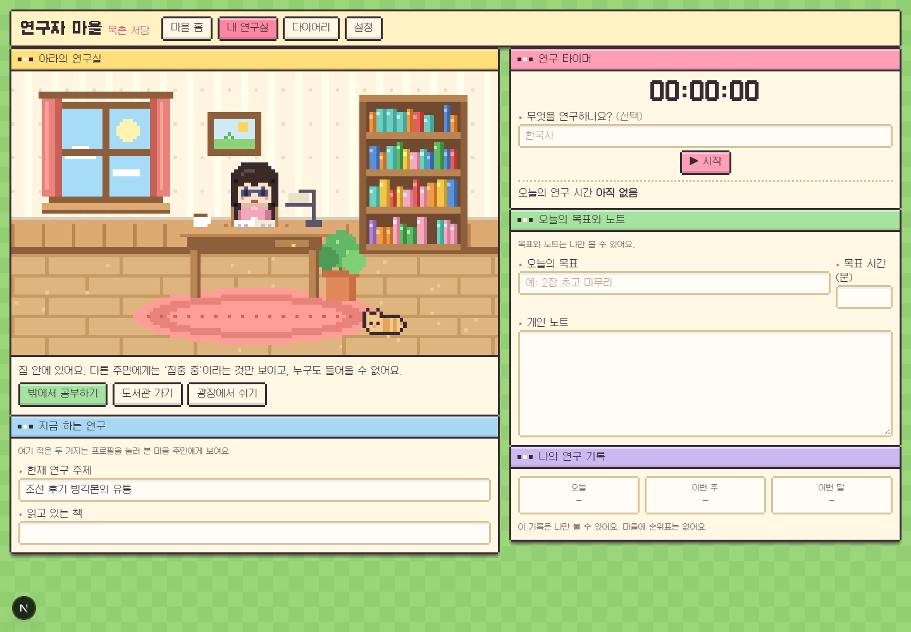

# 연구자 마을 (Research Village)

6명이 함께 살아가는 작은 디지털 연구 마을. 각자의 집에서 연구하다가, 집 밖으로 나오면 서로 만날 수 있습니다.



| 밤의 마을 | 내 연구실 |
| --- | --- |
|  |  |

화면은 도트 게임 풍입니다. 마을·캐릭터·연구실은 이미지 파일 없이 `src/pixel/`의 코드가 캔버스에 직접 그리고, 글꼴은 도트 한글 폰트 [갈무리](https://github.com/quiple/galmuri)(SIL OFL)를 씁니다.

## 지금 되는 것

- 이메일 회원가입·로그인, 프로필과 캐릭터 꾸미기
- 6명 정원의 비공개 마을 만들기, 초대 링크(7일 만료·재발급·폐기)로 입주
- **한 계정으로 여러 마을(최대 5개)**: 맨 위 마을 이름 메뉴에서 바꾸거나 "＋ 다른 마을 추가". 마을마다 따로 — 내 집(연구실 건물), 연구 상태·말풍선, 대화, 도서관, 광장 외침·소식. 마을과 상관없이 하나 — 프로필·캐릭터, **연구실 안(화이트보드·포스트잇·책장)**, 다이어리·일지·연구노트·할 일·마감 일정. 연구실은 나와 같은 마을에 사는 사람이면 어느 마을에서든 볼 수 있고, 마지막에 있던 마을을 기억함
- 마을 지도(도트 스타일): 연구실 6채, 집 앞 책상, 도서관, 광장, 게시판, 계절·시간대 변화
- 화면 테두리는 1px 도트 선
- 지도에서 내 연구실 앞 책상을 누르면 밖에 나와 앉고(열린 연구), 다른 주민의 책상을 누르면 프로필이 열림
- **연구실 안쪽 꾸미기**: 내 연구실의 작은 그림을 눌러 크게 열고 "꾸미기"를 눌러서 벽지 색·무늬, 바닥(마루·타일·장판), 책상(원목·흰색 시스템 책상)과 책상 위 물건(책·노트북·공책·흰 종이·문방사우·머그컵), 커튼·러그 색과 모양, 창밖 풍경(비·눈·벚꽃 등), 반려동물(고양이·강아지·헤드위그·듀오링고·다람쥐·기저귀 입은 아기), 소품(화분·큰 화분·빈백·지구본·자개 명패·수석·윤회매·위츄·슬라임·빨간 기차·크리스마스 트리·맥주 발효통·돌잔치 돌상(HAPPY BIRTHDAY 가랜드))을 고르면 미리보기와 함께 바로 저장됨. 다른 주민이 방문해도 같은 모습으로 보임
- **연구실 건물 고르기**: 움집·사무실 건물·기본 집(빨간 지붕)·한옥 중 선택. 건물마다 색이 정해져 있어 지붕·벽 색 고르기는 없음
- 연구 상태(집중 / 열린 연구 / 공동 연구 / 휴식 / 오프라인)에 따라 캐릭터가 이동하고 다른 주민 화면에 실시간 반영
- **내 연구실**: 오늘의 일지(날짜별, 자동 저장), 카테고리별 연구노트, 화이트보드, 연구 성과 — 모두 나만 쓰고 볼 수 있는 일지·노트와 주민에게 보이는 보드를 구분
- **연구실 방문**: 다른 주민의 연구실을 눌러 들어가 볼 수 있음(집중 연구 중이어도). 화이트보드에 포스트잇을 붙이거나 고민에 댓글 남기기
- **게시판 새 글 표시**: 마을 게시판에 이웃이 새 글을 올리면 지도의 게시판 위에 노란 테두리를 두른 반짝이는 N이 뜨고(숫자는 표시하지 않음), 게시판을 열어 읽으면 사라짐(내가 쓴 글은 세지 않음, 읽음 표시는 이 기기에 기억)
- **스터디 공지 알람**: 도서관에서 요일·시간(알림 시각 0/5/10/30분 전 선택)·Zoom 링크를 정해 두면, 서버(pg_cron, 매분)가 그 시간에 고른 사람(비우면 마을 모두)에게 `study_alarm` 알림을 만들어 팝업(Zoom 참여 버튼)과 푸시로 전달. 집중 연구 중이면 팝업을 건너뛰고 끝난 뒤 30분 안이면 띄움. 마을당 10개, Zoom 주소만 허용
- **마지막 접속 시각**: 오프라인인 이웃은 마을 주민 목록에 "3시간 전 접속"처럼(이틀 넘으면 "N일째 안 와요"), 프로필에는 마지막 접속 날짜·시각이 보임. 접속해 있으면서 오프라인을 고른 사람은 보이지 않음
- **여러 마을 접속 표시**: 한 마을에 접속해 있으면 내가 속한 모든 마을에서 온라인으로 보임(탭을 닫으면 모든 마을에서 오프라인)
- **끌어서 순서 바꾸기**: 도서관의 함께 쓰는 책(주민 누구나), 내 연구실의 연구 성과 책장과 좋아하는 책(주인만, 단 사이로도 이동)을 끌어서 순서를 바꿈. 마우스는 끌기, 폰은 꾹 눌러서 끌기, 키보드는 스페이스+화살표
- **좋아하는 책 책장**: 내 연구실 왼쪽에 4단 책장이 생기고, 연구실 화면의 "좋아하는 책"에서 원하는 단에 책을 꽂음(책등 색 선택, 한마디, 단 옮기기, 단마다 테마 이름 짓기, 한 단 14권·모두 40권까지). 이웃이 연구실에 놀러 오면 구경할 수 있음
- **이사 떡 돌리기**: 마을마다 한 번, 팥시루떡·무지개떡·송편 중 하나를 골라 이웃 모두의 책상에 올리고 알림을 보냄(받은 이웃은 알림에서 "잘 먹을게요"로 답함). 홈에 카드가 뜨고, 설정에서도 돌릴 수 있음
- **창 끌어서 순서 바꾸기**: 홈(왼쪽·가운데 칸), 내 연구실 오른쪽 칸, 도서관(왼쪽·오른쪽 칸)에서 창 제목줄을 끌면 같은 칸 안에서 순서가 바뀌고 이 기기에 기억됨(`WindowColumn`)
- **공동 공부 목표(도서관)**: 같은 마을 사람 1~5명을 골라 목표를 정하고, 각자 "목표 완료"를 누르면 됨(취소 가능). 모두 누르면 목표 달성 → *깜짝 이벤트(업데이트 소식에는 적지 않음)*: 홈 지도의 광장에 구성원이 모여 폴짝 뛰고 색종이가 쏟아지며 "책걸이!" 현수막이 뜸(24초, 달성 1분 반 안에 홈을 보고 있을 때). 마을당 진행 중 8개까지. 달성한 목표는 함께 쓰는 책장 오른쪽에 금화(날짜·목표, 눌러서 보기)로 쌓이고 지울 수 없음(많아지면 작게 줄여 전부 표시). 책걸이 선물은 송편+막걸리. 서버: `study_goals`, `study_goal_members`, RPC `create_study_goal`, `set_study_goal_done`
- **연구실 포털(쥐구멍)**: 연구실 그림의 벽 아래 작은 쥐구멍(보랏빛이 새어 나옴)을 누르면 이동할 연구실 목록 팝업이 뜨고, 마을로 나가지 않고 다른 사람의 연구실(또는 내 연구실)로 바로 이동. 내 연구실은 큰 그림에서, 이웃 연구실 화면에서도 누를 수 있음. 캐릭터 꾸미기에 투블럭 머리와 에어팟이 추가됨
- **기간형 공동 목표**: 공동 목표를 "기간 동안 매일 체크"로 만들면(시작·끝·주 N일, 7~120일) 참여자의 연구실 "오늘의 체크리스트"에 매일 `공동 공부: 활동`이 올라오고(체크는 오늘·어제만), 기간 다음 날 00:05(KST, pg_cron `habit-goals`)에 판정: 기준 = 기간 일수 × N/7(올림), 모든 참여자가 채웠으면 달성(책걸이·기념주화·송편과 막걸리), 아니면 조용히 "아쉽게 끝났어요"(지울 수 있음). 만든 사람·마을 장은 진행 중 목표의 이름·메모·참여자·종료일·주 N일을 고치거나 지울 수 있음. 서버: `study_goal_checks`, RPC `create_habit_goal`, `set_goal_check`, `update_study_goal`, `finalize_habit_goals`
- **크리스마스 광장(깜짝)**: 11월 25일~12월 25일엔 광장 분수가 거대한 크리스마스 트리로 바뀌고 가로등까지 반짝이 전구 줄이 이어짐. 업데이트 소식에는 적지 않음(`src/pixel/christmas.ts`)
- **소원구슬**: 광장의 구슬을 눌러 마을에 추가·수정됐으면 하는 기능을 적음(개인 소원이 아니라 기능 요청이며 24시간 안에 검토한다고 안내)(하루 3개, 마을 사람 모두의 소원 목록과 처리 상태 확인). 처리 방법은 `docs/WISHES.md`
- **마을 건물**: 마을 장(관리자)만 설정 → 마을 관리에서 도서관 건물을 기본 도서관 또는 성균관대 비천당(단청 두른 팔작지붕 한옥)으로 바꿀 수 있고, 모든 주민의 지도에 반영됨
- **함께 쓰는 책 제목 고치기**: 도서관의 책을 연 뒤 "제목·주제 고치기"로 제목·주제를 바꿈(책을 시작한 사람과 마을 장)
- **광장의 트럭(깜짝 요소라 업데이트 소식에는 적지 않음)**: 새벽 2시~3시 30분에 접속해 있으면 2~4일에 한 번꼴로 간헐적으로 **야식 트럭**이 광장에 나타나고(떡볶이 → 붕어빵 → 컵라면+오뎅 순서로 돌아감), 아침 6시~9시 30분에는 매일 **한식 아침밥상 밥차**가 와요(날마다 다른 밥상). 눌러서 메뉴를 보고 먹을 수 있고, 알림은 보내지 않아요. 접속한 기기의 시계를 기준으로 날짜만으로 정해져서 서버 설정이 필요 없어요.
- **오늘의 말풍선**: 캐릭터 위에 30자까지 짧은 말풍선(바꾸거나 지우기 전까지 유지)
- **마을 게시판 소식**: 지도의 게시판을 누르면 학회·채용·연구비·학술 뉴스를 올리고 볼 수 있는 소식 창이 열림(링크·마감일 지원)
- **화이트보드**: 내가 고민하는 문제와 주민들의 댓글, 화이트보드에 붙는 포스트잇
- **책장**: 연구 성과(논문·단행본·학위논문·발표)를 꽂고 RISS 링크 연결
- **대화**: 집 앞 책상에 나와 있는(열린 연구) 주민에게 대화를 신청하고, 수락하면 1:1 실시간 채팅
- **도서관**: 주제를 정해 만드는 공동 집필 책(주민들이 아래로 이어 씀, 완결 처리), Zoom 회의 링크 등록·알림·참여
- **알림**: 포스트잇·댓글·대화 신청·Zoom 회의 등록 시 실시간 알림과 배지
  - **앱 설치·폰 푸시**: 홈 화면에 추가하면 앱처럼 열리고(아이콘·manifest), 설정에서 켜면 이웃의 던지기·선물·메시지가 폰 알림으로 옴(열어 보는 중·집중 연구 중에는 안 울림, 내용은 담지 않음). 서버 설정은 `docs/PUSH.md`
- **캐릭터 꾸미기**: 머리 11종·머리색 16색·표정 6종(다크서클 포함)·얼굴(없음·면도 자국·수염)·옷 14종·바지 7색·신발 4종·모자 5종·액세서리 9종(여러 개 동시에)·소품 12종(손에 든 것 1개 + 가방 1개)
- **내 연구실 작업 화면**: 가운데에 글쓰기 창(오늘의 일지·연구노트·다이어리·화이트보드/책장 중 하나)이 크게 열리고, 왼쪽에는 작은 연구실 그림과 항목 목록, 오른쪽에는 마감 일정·할 일이 있음. "집중 모드"를 켜면 양옆이 사라지고 글쓰기 창만 화면 가득 남음. 창 제목줄은 모두 노랑
- **기록 보호**: 일지·연구노트·다이어리는 자동 저장(입력을 멈추면 0.8초 뒤)되고, 쓰는 동안 이 기기에도 임시 보관돼서 저장이 실패하거나 탭이 닫혀도 다시 열면 되살아남. 저장 실패 시 3·6·12·30초 간격으로 자동 재시도, 저장 안 된 글이 있으면 탭을 닫을 때 경고. 두 기기·탭에서 동시에 고치면 조용히 덮어쓰지 않고 어느 쪽을 남길지 물으며 고르지 않은 쪽은 이력에 남음. 고치거나 지우기 전 글은 서버가 자동으로 이력에 남겨 되돌릴 수 있고(글 아래 "이력"), 지운 노트·다이어리는 "삭제한 글 보관함"에서 되살림
- **찾기·내보내기**: 내 일지·연구노트·다이어리 전체에서 단어·기간·종류로 찾고, 결과를 누르면 그 글이 열림. 전체 또는 기간별로 텍스트(.md) 파일로 내려받거나 복사, 글 하나씩 복사·텍스트로 받기도 가능. 한 달 넘게 내려받지 않으면 알려 줌
- **일지 공개**: 오늘의 일지는 나만 보기가 기본이고, 글마다 "마을 주민에게 공개"로 바꾸면(내가 사는 마을 중 골라서) 그 마을 주민이 내 연구실 화이트보드 칸의 "공개 일지"에서 읽음. 공개를 끄면 바로 사라짐
- **이웃과 주고받기**
  - **던지기**: 이웃이 마을에 나와 있을 때(광장·도서관·집 앞 책상) 그 캐릭터를 눌러 열리는 프로필에서 학위논문·마감 알림·학회 하고 남은 과자을 던지면 마을 지도에서 물건이 날아가 별이 튀고, 받은 사람에게 알림이 감(알림에서 "되받아치기"도 가능)
  - **건네기**: 이웃 연구실을 방문해 책상을 누르고 커피·아이스 아메리카노·차·맥주와 간식(요거트 찹쌀떡·약과·귤·사과·미니쉘·하리보)을 한마디와 함께 올려 둠. 하루 동안 책상 위에 보이고, 보낸 사람과 한마디는 받은 사람에게만 보임(방문자는 선물 종류만 봄)
  - **책 추천**: 이웃 연구실의 책장 탭에서 제목과 한마디를 남기면 책장에 추천 책이 꽂히고 "추천받은 책" 목록에 뜸(주인이나 보낸 사람이 뗄 수 있음)
  - **공개 일지 반응·댓글**: 공개된 일지에 하트·좋아요(따봉)·커피·책 도트 아이콘으로 반응하고(여러 명이면 숫자가 올라감) 댓글도 남길 수 있음, 주인에게 알림
  - **마감 응원**: 마감 일정을 "공개"로 두면 이웃이 연구실에서 보고 "파이팅!"을 눌러 줌, 주인은 마감 옆에서 누가 응원했는지 봄
  - **마감 독촉**: 3일 넘게 안 들어온 이웃의 프로필에서 "마감 독촉하기"(같은 사람에게 12시간에 한 번). 오래 안 온 주민 옆에는 "N일째 안 와요"가 뜨고, 며칠 만에 들어오면 다가오는 마감과 받은 독촉을 보여 주는 안내 카드가 뜸
  - **방해 금지**: "집중 연구" 중에는 팝업 없이 알림함에만 조용히 쌓임
- **마감 일정·오늘의 체크리스트**: 내 연구실에서 마감 날짜를 넣으면 D-○○이 뜨고(여러 개), 오늘의 체크리스트는 적고 눌러서 바로 체크(못 끝낸 일은 다음 날로 이어지고 끝낸 일은 그날만 보임). 둘 다 나만 볼 수 있음
- **다이어리**: 내 연구실 안에서 쓰고, 쓴 글은 나만 볼 수 있음(종류·제목·링크 지원)
- **광장 전체 채팅방**: 홈 화면 아래. 광장에 나와 있는(휴식 중) 주민이 모두에게 외치고, 마을 주민 모두가 실시간으로 읽음
- 주민 프로필, 집 꾸미기, 마을 관리, 내 데이터 내려받기, 마을 떠나기, 계정 삭제

연구 타이머는 의도적으로 없습니다. 순위표도 없습니다.

아직 없는 것: RISS 검색 결과 자동 가져오기(링크는 직접 붙여 넣음), Zoom 회의 자동 생성(Zoom 앱 연동 필요), 단체 채팅, 사진 첨부, 논문 알림·게시판 내용, 소셜 로그인, 비밀번호 재설정 메일. 동작하지 않는 버튼은 두지 않았습니다.

## 구조

| 위치 | 내용 |
| --- | --- |
| `supabase/migrations/` | 테이블, RLS 정책, RPC 함수 (정원·초대·접속 상태·대화) |
| `src/hooks/` | `useAuth`, `useVillage`(실시간 동기화·heartbeat), `useJournal`, `useResearchNotes`, `useRoom`, `useChat`, `useLibrary`, `useNotifications`, `useDiary` |
| `src/pixel/` | 도트 스프라이트(캐릭터·집·나무·연구실)를 그리는 코드 |
| `src/components/` | `VillageScene`(캔버스 마을), `StudyRoom`, `RoomVisit`, `ChatView`, `LibraryView`, `DiaryView`, `ProfileModal`, `SettingsView` 등 |
| `scripts/test-backend.mjs` | 정원·권한·대화·도서관 규칙 검증 |

서버 코드가 없는 정적 앱입니다. 브라우저는 공개(anon) 키만 쓰고, 모든 접근 제어는 데이터베이스의 Row Level Security가 맡습니다.

- 모든 마을 데이터는 `village_id`로 분리되고, 주민이 아니면 읽을 수 없습니다.
- 정원 6명은 `houses` 6행을 잠그며 배정하는 방식으로 DB가 보장합니다(동시 가입 포함).
- 일지와 연구노트는 본인만 읽을 수 있고, 대화는 참가자 두 사람만 읽을 수 있습니다. 대화 신청은 서버가 상대의 상태(열린 연구)를 확인한 뒤에만 만들어집니다.
- 공동 집필 책에 이어 쓴 글은 작성자가 마을을 떠나도 남고, 작성자만 '떠난 주민'으로 바뀝니다.
- 접속 여부(`last_seen_at`)는 서버 시각으로만 기록됩니다. 150초 넘게 접속이 끊기면 오프라인으로 보이고, 다시 들어올 때 상태는 '휴식'으로 돌아갑니다.

## 실제로 쓰기 (Supabase + 정적 호스팅)

1. [supabase.com](https://supabase.com)에서 프로젝트를 만듭니다.
2. SQL Editor에 `supabase/migrations/20261112000000_phase1.sql` 내용을 붙여 넣고 실행합니다.
   (CLI를 쓴다면 `npx supabase link` 후 `npx supabase db push`)
3. Authentication → URL Configuration의 Site URL에 배포할 주소를 넣습니다.
4. `.env.example`을 `.env.local`로 복사하고 Project URL과 anon(publishable) 키를 넣습니다.
5. `npm install && npm run build` → `out/` 폴더를 Vercel·Netlify·GitHub Pages 등에 올립니다.
   하위 경로에 올릴 때는 빌드 전에 `NEXT_PUBLIC_BASE_PATH=/경로`를 지정합니다.

## 내 컴퓨터에서 실행

Docker가 필요합니다.

```bash
npm install
npm run db:start        # 로컬 Supabase 시작, 출력된 API URL과 anon key를 .env.local 에 넣기
npm run dev             # http://localhost:3000
npm run test:backend    # 권한·정원·대화·도서관 규칙 검사
```

두 개의 브라우저(또는 시크릿 창)로 각각 가입해 한쪽에서 마을을 만들고 설정의 초대 링크로 다른 쪽이 입주하면, 상태 변화가 서로에게 바로 보입니다.
