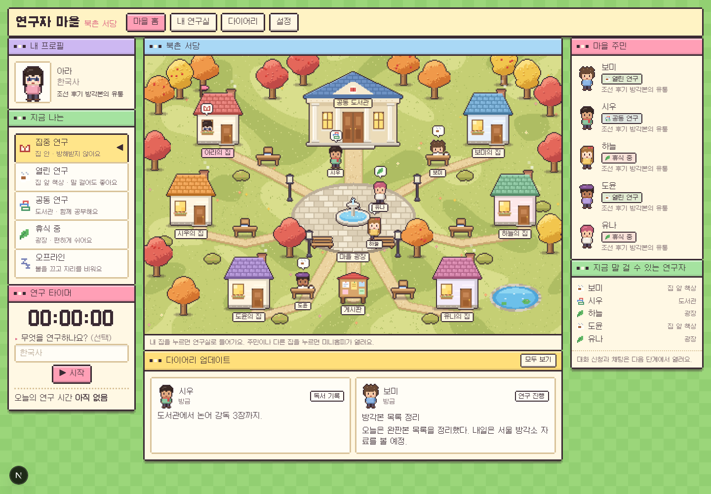
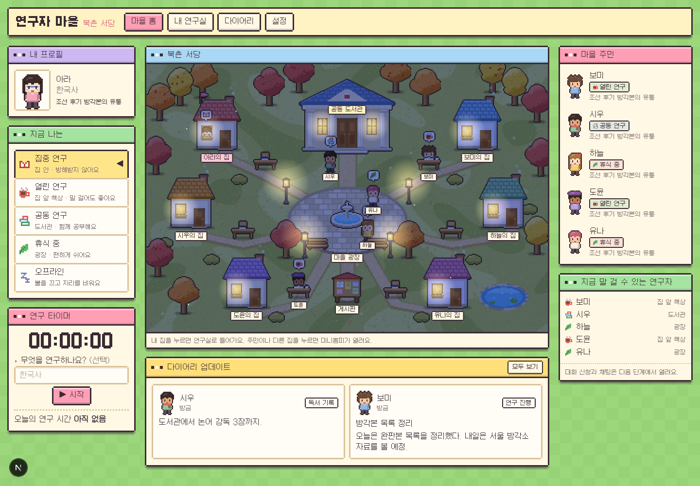
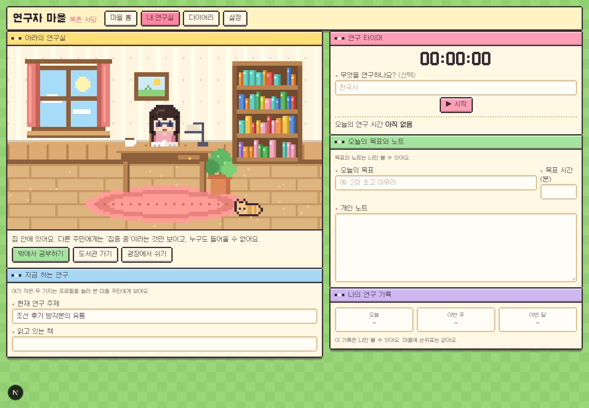

# 연구자 마을 (Research Village)

6명이 함께 살아가는 작은 디지털 연구 마을. 각자의 집에서 연구하다가, 집 밖으로 나오면 서로 만날 수 있습니다.



| 밤의 마을 | 내 연구실 |
| --- | --- |
|  |  |

화면은 도트 게임 풍입니다. 마을·캐릭터·연구실은 이미지 파일 없이 `src/pixel/`의 코드가 캔버스에 직접 그리고, 글꼴은 도트 한글 폰트 [갈무리](https://github.com/quiple/galmuri)(SIL OFL)를 씁니다.

## 지금 되는 것

- 이메일 회원가입·로그인, 프로필과 캐릭터 꾸미기
- 6명 정원의 비공개 마을 만들기, 초대 링크(7일 만료·재발급·폐기)로 입주
- **한 계정으로 여러 마을(최대 5개)**: 맨 위 마을 이름 메뉴에서 바꾸거나 "＋ 다른 마을 추가". 마을마다 따로 — 내 집(연구실 건물), 연구 상태·말풍선, 대화, 도서관, 광장 외침·소식. 마을과 상관없이 하나 — 프로필·캐릭터, **연구실 안(화이트보드·포스트잇·책장)**, 다이어리·일지·연구노트·할 일·마감 일정. 연구실은 나와 같은 마을에 사는 사람이면 어느 마을에서든 볼 수 있고, 마지막에 있던 마을을 기억함
- 마을 지도(도트 스타일): 연구실 6채, 집 앞 책상, 도서관, 광장, 게시판, 계절·시간대 변화
- 화면 테두리는 1px 도트 선
- 지도에서 내 연구실 앞 책상을 누르면 밖에 나와 앉고(열린 연구), 다른 주민의 책상을 누르면 프로필이 열림
- **연구실 안쪽 꾸미기**: 설정(또는 연구실의 "꾸미기" 버튼)에서 벽지 색·무늬, 바닥(마루·타일·장판), 책상(원목·흰색 시스템 책상)과 책상 위 물건(책·노트북·공책·흰 종이·문방사우·머그컵), 커튼·러그 색과 모양, 창밖 풍경(비·눈·벚꽃 등), 반려동물(고양이·강아지·해리포터 부엉이·듀오링고 부엉이), 소품(화분·큰 화분·빈백·지구본·자개 명패·수석)을 고르면 미리보기와 함께 바로 저장됨. 다른 주민이 방문해도 같은 모습으로 보임
- **연구실 건물 고르기**: 움집·사무실 건물·기본 집(빨간 지붕)·한옥 중 선택. 건물마다 색이 정해져 있어 지붕·벽 색 고르기는 없음
- 연구 상태(집중 / 열린 연구 / 공동 연구 / 휴식 / 오프라인)에 따라 캐릭터가 이동하고 다른 주민 화면에 실시간 반영
- **내 연구실**: 오늘의 일지(날짜별, 자동 저장), 카테고리별 연구노트, 화이트보드, 책장 — 모두 나만 쓰고 볼 수 있는 일지·노트와 주민에게 보이는 보드를 구분
- **연구실 방문**: 다른 주민의 연구실을 눌러 들어가 볼 수 있음(집중 연구 중이어도). 화이트보드에 포스트잇을 붙이거나 고민에 댓글 남기기
- **오늘의 말풍선**: 캐릭터 위에 30자까지 짧은 말풍선(12시간 뒤 자동으로 사라짐)
- **마을 게시판 소식**: 지도의 게시판을 누르면 학회·채용·연구비·학술 뉴스를 올리고 볼 수 있는 소식 창이 열림(링크·마감일 지원)
- **화이트보드**: 내가 고민하는 문제와 주민들의 댓글, 화이트보드에 붙는 포스트잇
- **책장**: 연구 성과(논문·단행본·학위논문·발표)를 꽂고 RISS 링크 연결
- **대화**: 집 앞 책상에 나와 있는(열린 연구) 주민에게 대화를 신청하고, 수락하면 1:1 실시간 채팅
- **도서관**: 주제를 정해 만드는 공동 집필 책(주민들이 아래로 이어 씀, 완결 처리), Zoom 회의 링크 등록·알림·참여
- **알림**: 포스트잇·댓글·대화 신청·Zoom 회의 등록 시 실시간 알림과 배지
- **캐릭터 꾸미기**: 머리 11종·머리색 16색·표정 5종·수염 5종·다크서클·옷 14종·바지 7색·신발 4종·모자 5종·액세서리 9종(여러 개 동시에)·소품 12종(손에 든 것 1개 + 가방 1개)
- **연구실 창 정리**: 마감 일정·할 일·일지·연구노트·다이어리 창을 위/아래로 옮기고 접고 펼 수 있으며(모두 접기/펴기 포함), 순서와 접힘 상태는 내 계정에 저장됨
- **마감 일정·할 일**: 내 연구실에서 마감 날짜를 넣으면 D-○○이 뜨고(여러 개), 할 일은 체크리스트(날짜를 넣으면 D-day 도 표시). 둘 다 나만 볼 수 있음
- **다이어리**: 내 연구실 안에서 쓰고, 쓴 글은 나만 볼 수 있음(종류·제목·링크 지원)
- **광장 전체 채팅방**: 홈 화면 아래. 광장에 나와 있는(휴식 중) 주민이 모두에게 외치고, 마을 주민 모두가 실시간으로 읽음
- 주민 프로필, 집 꾸미기, 마을 관리, 내 데이터 내려받기, 마을 떠나기, 계정 삭제

연구 타이머는 의도적으로 없습니다. 순위표도 없습니다.

아직 없는 것: RISS 검색 결과 자동 가져오기(링크는 직접 붙여 넣음), Zoom 회의 자동 생성(Zoom 앱 연동 필요), 단체 채팅, 사진 첨부, 논문 알림·게시판 내용, 소셜 로그인, 비밀번호 재설정 메일. 동작하지 않는 버튼은 두지 않았습니다.

## 구조

| 위치 | 내용 |
| --- | --- |
| `supabase/migrations/` | 테이블, RLS 정책, RPC 함수 (정원·초대·접속 상태·대화) |
| `src/hooks/` | `useAuth`, `useVillage`(실시간 동기화·heartbeat), `useJournal`, `useResearchNotes`, `useRoom`, `useChat`, `useLibrary`, `useNotifications`, `useDiary` |
| `src/pixel/` | 도트 스프라이트(캐릭터·집·나무·연구실)를 그리는 코드 |
| `src/components/` | `VillageScene`(캔버스 마을), `StudyRoom`, `RoomVisit`, `ChatView`, `LibraryView`, `DiaryView`, `ProfileModal`, `SettingsView` 등 |
| `scripts/test-backend.mjs` | 정원·권한·대화·도서관 규칙 검증 |

서버 코드가 없는 정적 앱입니다. 브라우저는 공개(anon) 키만 쓰고, 모든 접근 제어는 데이터베이스의 Row Level Security가 맡습니다.

- 모든 마을 데이터는 `village_id`로 분리되고, 주민이 아니면 읽을 수 없습니다.
- 정원 6명은 `houses` 6행을 잠그며 배정하는 방식으로 DB가 보장합니다(동시 가입 포함).
- 일지와 연구노트는 본인만 읽을 수 있고, 대화는 참가자 두 사람만 읽을 수 있습니다. 대화 신청은 서버가 상대의 상태(열린 연구)를 확인한 뒤에만 만들어집니다.
- 공동 집필 책에 이어 쓴 글은 작성자가 마을을 떠나도 남고, 작성자만 '떠난 주민'으로 바뀝니다.
- 접속 여부(`last_seen_at`)는 서버 시각으로만 기록됩니다. 150초 넘게 접속이 끊기면 오프라인으로 보이고, 다시 들어올 때 상태는 '휴식'으로 돌아갑니다.

## 실제로 쓰기 (Supabase + 정적 호스팅)

1. [supabase.com](https://supabase.com)에서 프로젝트를 만듭니다.
2. SQL Editor에 `supabase/migrations/20261112000000_phase1.sql` 내용을 붙여 넣고 실행합니다.
   (CLI를 쓴다면 `npx supabase link` 후 `npx supabase db push`)
3. Authentication → URL Configuration의 Site URL에 배포할 주소를 넣습니다.
4. `.env.example`을 `.env.local`로 복사하고 Project URL과 anon(publishable) 키를 넣습니다.
5. `npm install && npm run build` → `out/` 폴더를 Vercel·Netlify·GitHub Pages 등에 올립니다.
   하위 경로에 올릴 때는 빌드 전에 `NEXT_PUBLIC_BASE_PATH=/경로`를 지정합니다.

## 내 컴퓨터에서 실행

Docker가 필요합니다.

```bash
npm install
npm run db:start        # 로컬 Supabase 시작, 출력된 API URL과 anon key를 .env.local 에 넣기
npm run dev             # http://localhost:3000
npm run test:backend    # 권한·정원·대화·도서관 규칙 검사
```

두 개의 브라우저(또는 시크릿 창)로 각각 가입해 한쪽에서 마을을 만들고 설정의 초대 링크로 다른 쪽이 입주하면, 상태 변화가 서로에게 바로 보입니다.
